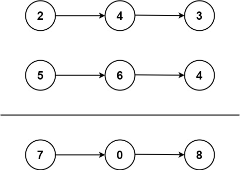

# 0002. add Two Numbers

- **难度**：Medium
- **标签**：recursive,linked-list,math
- **链接**：https://leetcode.cn/problems/add-two-numbers/
- **日期**：2026-10-20

## 题目描述

给你两个 非空 的链表，表示两个非负的整数。它们每位数字都是按照 逆序 的方式存储的，并且每个节点只能存储 一位 数字。

请你将两个数相加，并以相同形式返回一个表示和的链表。

你可以假设除了数字 0 之外，这两个数都不会以 0 开头。

**约束**：

- 
- 

**示例**：



```
输入：l1 = [2,4,3], l2 = [5,6,4]
输出：[7,0,8]
解释：342 + 465 = 807.
```

```
输入：l1 = [0], l2 = [0]
输出：[0]
```

```
输入：l1 = [9,9,9,9,9,9,9], l2 = [9,9,9,9]
输出：[8,9,9,9,0,0,0,1]
```

## 思路

（用自己的话写：为什么想到这个方法，而不是方法本身。）

deepseek解答:
做这种链表题，强烈建议你套用下面这个模版，代码会少一半，而且绝对不出错：

第一板斧：新建一个“哑节点” (Dummy Node)

```python
dummy = ListNode(0) # 创建一个虚拟的头
curr = dummy        # 用一个游标去拼接后面的节点
# 最后只需 return dummy.next 就能拿到完整的链表
```

第二板斧：统一的取值逻辑
不要去写复杂的 if 节点存在... else 不存在...。直接在循环开头，如果是空节点就给 0。

```python
val1 = l1.val if l1 else 0
val2 = l2.val if l2 else 0
```

第三板斧：万能循环条件
不要用 while True 然后里面 break。想想看，只要 l1 有节点，或者 l2 有节点，或者还有进位，计算就不能停！

```python
while l1 or l2 or carry: ...
```

## 复杂度

- 时间：O(?)
- 空间：O(?)

## 踩坑 / 关键点

- 

## 相关题目

- 